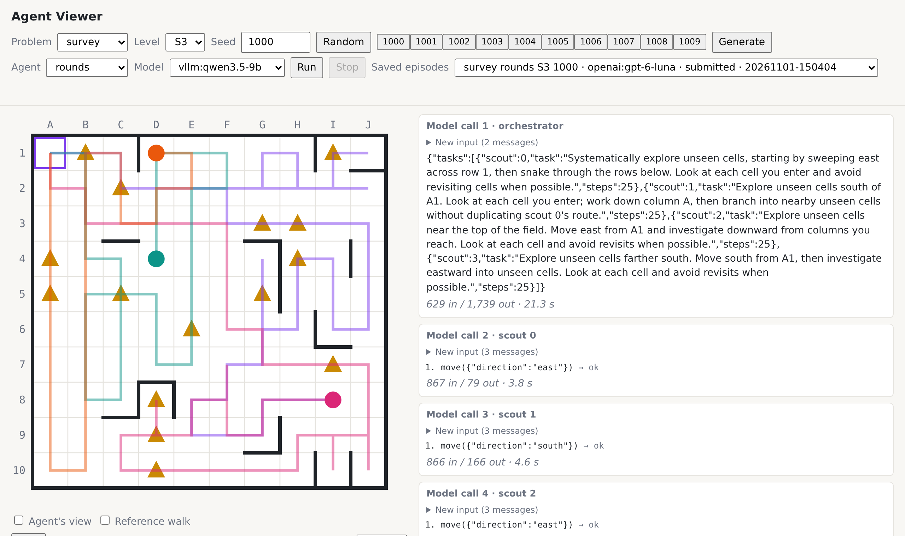
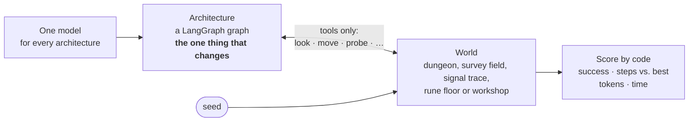
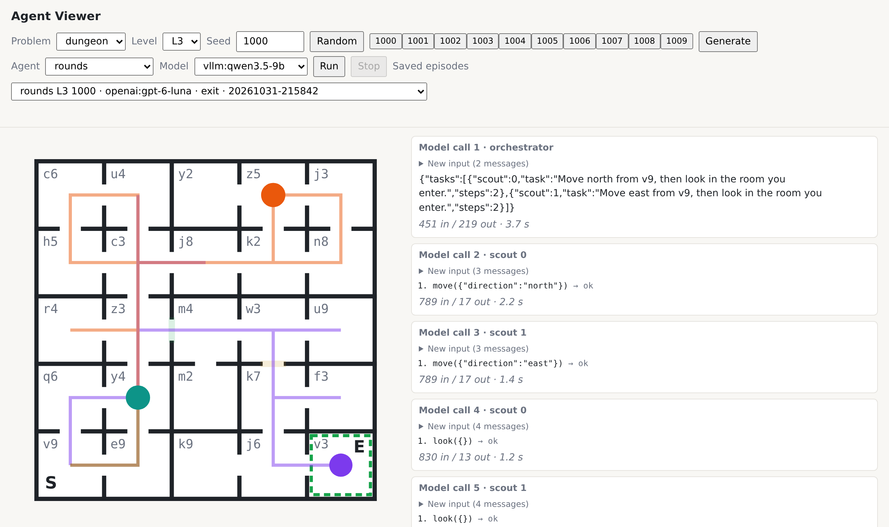
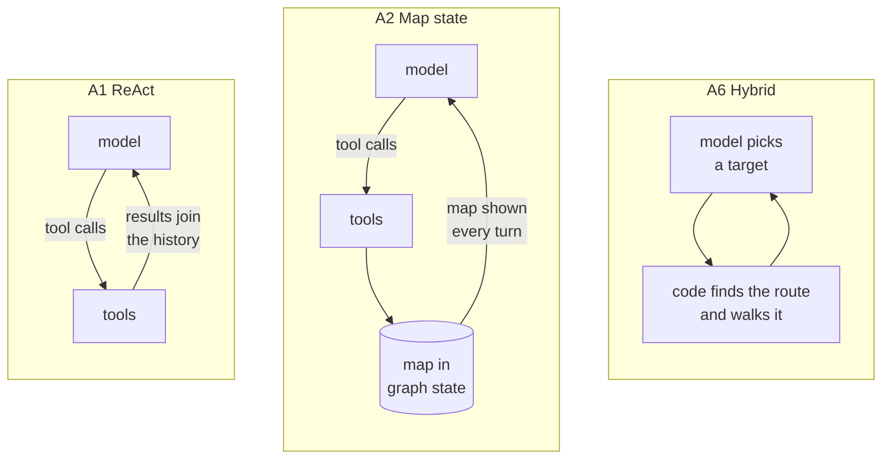
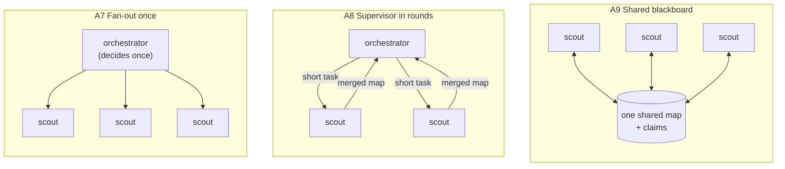
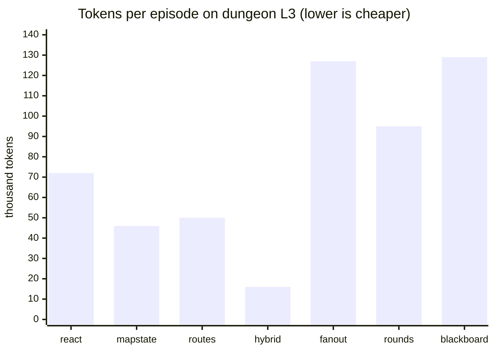
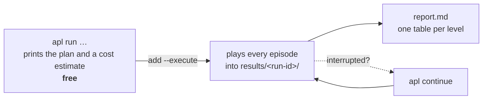

# langgraph-architecture-lab

**Same model, same tools, same world. Only the agent's graph changes.** So when one agent does
better than another, the architecture is the reason.

This repository is a lab for comparing hand-built [LangGraph](https://langchain-ai.github.io/langgraph/)
agent architectures on generated puzzles. Code does the scoring and knows the right answer, so
there is no LLM judge.


<sub>The browser viewer replaying architecture A8 ("supervisor in rounds") on survey field S3.
An orchestrator (first card on the right) gives four scouts short tasks. Each colored line is
one scout's trail, and the triangles are ore deposits. The scouts found all 15.</sub>

> **Status:** M11 built: a fifth problem, the workshop, alongside the dungeon, the survey field, the
> signal trace and the rune floor; every architecture in the plan is in. First
> results (M4, dungeon only, a first look): [`docs/findings/m4-first-comparison.md`](docs/findings/m4-first-comparison.md).

---

## How it works



1. **A seed builds a world.** The same seed always builds the same world, and code knows the
   best possible answer.
2. **An architecture plays it.** It can only call the problem's tools, like a player who sees
   one room at a time.
3. **Code scores it.** Did it succeed? How many steps did it take compared with the best? How
   many tokens, model calls and seconds did it use?

## Try it in one minute

You need [uv](https://docs.astral.sh/uv/). These commands need no model and cost nothing.

```bash
uv sync
uv run apl dungeon show --level L3 --seed 1000 --route solution   # a dungeon and its shortest route
uv run apl survey show --level S2 --seed 1000                     # a survey field
uv run apl signal show --level T3 --seed 1000 --route reference   # a signal trace pipe
uv run apl rune show --level R1 --seed 1000 --route reference     # a rune floor
uv run apl workshop show --level W2 --seed 1000 --route reference # a workshop
uv run apl serve                                                  # the viewer: http://127.0.0.1:8765/
```

In the viewer, pick a problem, level and seed, and press **Generate** to see the world. Press
**Run** to watch an agent play it live; this needs a model (see [Model](#model)).

---

## The five problems

Architectures are compared only within a problem, never across problems.

### 1. The dungeon: find the exit


<sub>Dungeon L3, seed 1000. **S** is the start and **E** the exit. Each colored line is one
scout's trail, and the colored bars between rooms were locked doors.</sub>

A grid of rooms joined by doors. Some doors are locked and open only with a key of the same
color, which lies somewhere else. The agent sees only the room it is in.

| Tool | What it does |
| --- | --- |
| `look()` | Describe the room: exits (and their lock color), items, inventory, whether it is the exit |
| `move(direction)` | Go through an open door |
| `take(item)` | Pick up an item |
| `use(item, direction)` | Unlock a door with a key |

| Level | Grid | Challenge | Step budget |
| --- | --- | --- | --- |
| L1 | 3×3 | no locks | 6× the shortest solution |
| L2 | 4×4 | one key, one locked door | 6× the shortest solution |
| L3 | 5×5 | two chained keys, dead ends | 6× the shortest solution |

**Success** means reaching the exit. A solver checks that every dungeon can be solved and
records the shortest solution.

### 2. The survey field: count the deposits

A fogged grid of cells, some holding an ore deposit. Every agent starts in the north-west
corner, A1, and has to report how many deposits there are. The field is open, so several scouts
can each take a part of it. This is where splitting the work should pay off.

| Tool | What it does |
| --- | --- |
| `look()` | The cell's name, whether it has a deposit, the open directions, the field's size |
| `move(direction)` | Go to a neighboring cell |
| `submit(total)` | Give the number of deposits; this ends the episode |

| Level | Grid | Walls | Deposits | Step budget |
| --- | --- | --- | --- | --- |
| S1 | 6×6 | none | 6 | 3× a walk that enters every cell |
| S2 | 10×10 | none | 15 | 3× a walk that enters every cell |
| S3 | 10×10 | interior walls, dead ends | 15 | 3× a walk that enters every cell |

**Success** means submitting the right total.

### 3. The signal trace: find the broken segment

Water flows from a source S through numbered pipe segments; exactly one is broken, and it and
everything downstream of it are dry. The whole layout is given at the start, and every answer is
true, so a model can never be misled, only waste probes. An agent that tests segment after
segment needs about N probes; one that halves the suspects each time needs about log₂ N.

| Tool | What it does |
| --- | --- |
| `look()` | The layout again (it is also given free at the start) |
| `probe(segment)` | Whether water reaches that segment |
| `submit(segment)` | Name the broken segment; this ends the episode |

| Level | Segments | Layout | Reference | Step budget |
| --- | --- | --- | --- | --- |
| T1 | 16 | one straight run | 4 probes + submit | 16 |
| T2 | 64 | one straight run | 6 probes + submit | 64 |
| T3 | 64 | a tree with 4 pipe ends | about 7 probes + submit | 64 |

**Success** means naming the broken segment. The report also counts **wasted probes**: probes
whose answer earlier answers already implied.

### 4. The rune floor: learn the hidden rule

Cross a floor of colored tiles from S to G. Every tile's color is given at the start; a hidden
rule decides which steps are safe (for example: the tiles stepped on since S must go red, blue,
green, then repeat). A step the rule forbids is a trap and sends the agent back to S, and all
walks share one step budget. The only way to learn the rule is to be trapped by it, so this is
where learning from failure (A4 Reflexion) should pay off, and where an agent that keeps no
lesson walks into the same trap again.

| Tool | What it does |
| --- | --- |
| `look()` | The floor again (it is also given free at the start) |
| `move(direction)` | Step onto the next tile: safe, a trap (back to S), or the goal |

| Level | Floor | Hidden rule | Step budget |
| --- | --- | --- | --- |
| R0 | 7×5 | none: a fixed set of trap tiles (the control, nothing to learn) | 4× the shortest safe path |
| R1 | 7×5 | a cycle of 3 colors | 4× the shortest safe path |
| R2 | 9×7 | a cycle of 4 that doubles a color | 4× the shortest safe path |
| R3 | 9×7 | one color on odd rows, another on even rows | 4× the shortest safe path |

**Success** means reaching G. The report also counts **traps** and **repeated traps**: the same
tile sprung again in the same situation under the rule.

### 5. The workshop: plan before you craft

Craft one goal item from recipes the agent sees only by inspecting each item, with a limited stock
of raw materials. A scarce material (one unit) is needed in one branch, and the first recipe of an
item in another branch uses it too, one level down. An agent that crafts with the first recipe it
finds gets stuck; one that inspects the tree first and plans takes the other recipe and finishes.
This is where planning ahead (A3 plan-and-execute, A5 supervisor's researcher and crafter) should
pay off.

| Tool | What it does |
| --- | --- |
| `look()` | The goal, the stock and the inventory (also given free at the start) |
| `inspect(item)` | An item's recipes, or that it is a raw material |
| `gather(item)` | One unit of a raw material from the stock |
| `craft(item, recipe)` | Make an item with recipe 1 or 2 from the inventory |

| Level | Craftable items | Conflicts | Step budget |
| --- | --- | --- | --- |
| W1 | 3 | none | 3× the reference plan |
| W2 | 5 | one scarce material, one tempting recipe | 3× the reference plan |
| W3 | 8 | two | 3× the reference plan |

**Success** means crafting the goal. An episode ends **stuck** once the goal can no longer be made,
and the report counts the scarce units **wasted** on items the reference plan does not use them for.

---

## The architectures

Each one is a `StateGraph` written by hand in [`src/apl/arch/`](src/apl/arch/). The ID column
is used in the docs, and the name column is what you pass to `--arch`.

| ID | Name | Idea in one line | Dungeon | Survey | Signal | Rune | Workshop |
| --- | --- | --- | :---: | :---: | :---: | :---: | :---: |
| A1 | `react` | The model calls tools in a loop and remembers only through its message history | ✓ | ✓ | ✓ | ✓ | ✓ |
| A2 | `mapstate` | The explored map lives in graph state and is shown to the model every turn (on the signal trace: a probe log; on the rune floor: a walk log; in the workshop: a workshop log) | ✓ | ✓ | ✓ | ✓ | ✓ |
| A2r | `mapstate_routes` | A2, plus the shortest known route to each unexplored exit | ✓ | | | | |
| A3 | `plan_execute` | A planner writes subgoals, A2's agent carries them out in order, a replanner steps in only when a subgoal fails or the plan runs out | ✓ | ✓ | ✓ | ✓ | ✓ |
| A4 | `reflexion` | A2 that tries again: after a failed attempt (on the rune floor: a trap, with the walk log kept) it writes a note, the world restarts, all steps count | ✓ | ✓ | ✓ | ✓ | ✓ |
| A5 | `supervisor` | A supervisor hands tasks to a navigator (look, move) and an inventory helper (take, use), each a subgraph on A2's map (on the workshop: a researcher and a crafter) | ✓ | | | | ✓ |
| A6 | `hybrid` | Code keeps the map and walks the routes; the model only picks where to go (on the signal trace: code lists the probes that split the suspects best; on the rune floor: code lists the moves with what happened on each tile before; in the workshop: code lists the actions it can take now) | ✓ | | ✓ | ✓ | ✓ |
| A7 | `fanout` | An orchestrator sends out up to 4 scouts once; each explores alone | ✓ | ✓ | | | |
| A8 | `rounds` | An orchestrator gives scouts short tasks and replans on the map they all saw | ✓ | ✓ | | | |
| A9 | `blackboard` | No planner: scouts take turns on one shared map and claim unexplored exits | ✓ | ✓ | | | |

### One agent: where the memory lives



### Several scouts: how they coordinate



All scouts share one step budget, so every move by every scout counts. Each scout is A2's
map-state agent with a task, which makes A2 their single-agent baseline.

---

## First results (M4, dungeon)

<sub>Development seeds, one episode per cell, model `openai:gpt-6-luna`. These are tendencies
from a first look, not measurements. Details: [`docs/findings/m4-first-comparison.md`](docs/findings/m4-first-comparison.md).</sub>



- **Letting code do the walking pays off.** A6 `hybrid` was the cheapest and fastest on L3, with
  16k tokens against 50k for A2r.
- **Scouts did not pay off in small dungeons.** A7–A9 used 2 to 5 times A2's tokens and took
  more steps. A7 ran out of steps on L3.
- **So M5 adds the survey field**, an open board with no dead ends, where splitting the work
  should help.

---

## Running an experiment



```bash
uv run apl run --arch react --level all --seeds dev --limit 2            # plan only (free)
uv run apl run --arch react --level all --seeds dev --limit 2 --execute  # play it
uv run apl run --problem survey --arch react,fanout --level all --seeds dev --limit 1
uv run apl run --problem signal --arch react,hybrid --level all --seeds dev --limit 1
uv run apl run --problem rune --arch react,reflexion --level all --seeds dev --limit 1
uv run apl run --problem workshop --arch react,plan_execute --level all --seeds dev --limit 1
uv run apl continue results/<run-id> [--execute]                         # finish a cut-off run
uv run apl report results/<run-id>                                       # rebuild the report
```

Nothing calls a model until you add `--execute`. Each run writes a folder:

```text
results/<run-id>/
├── run.json          settings: model, levels, seeds, code version
├── episodes.jsonl    one row per episode: success, steps, best steps, tokens, calls, time
├── episodes/         each episode's tool log and model conversation
└── report.md         success rate and efficiency per architecture and level, with spread
```

**Seeds:** dev seeds (1000–1009) are for building and tuning. Test seeds (2000–2019) are kept
unseen for reported results, and the viewer refuses them.

---

## Watching an agent

`uv run apl serve` opens a local page at http://127.0.0.1:8765/ that only this machine can
reach.

- Pick a **problem, level and seed**, then an **agent** and a **model**, and press **Run**.
  Every move appears on the map as it happens.
- Above the turns, **How <agent> plays the <problem>** draws the agent's graph for that game and
  lists what it defines there: what the model sees, its memory, its tools and when it ends. During
  an episode the node behind the current step is lit.
- The side panel shows every model turn: what the model was told, its reasoning, its tool calls
  and their results. With scouts, each card says whether it was the orchestrator or which scout.
- **Agent's view** dims what no scout has seen. **Shortest solution** (or **Reference walk**)
  draws the best route. The slider steps back through the episode.
- Every episode is saved under `results/viewer/` and can be replayed from **Saved episodes**.

Local models (`vllm:`, `ollama:`) run straight away. A paid provider needs
`apl serve --execute`.

---

## Model

One setting picks the model for every architecture, in LangChain's `provider:model` form. Put it
in `.env` (never committed; [`.env.example`](.env.example) lists every setting):

```bash
APL_MODEL=vllm:qwen3.5-9b      # default: local vLLM, free
# APL_MODEL=ollama:qwen3:8b    # local Ollama
# APL_MODEL=openai:gpt-6-luna  # paid, needs OPENAI_API_KEY
```

<details>
<summary>vLLM server setup and the other settings</summary>

The default is Qwen3.5 9B on a local [vLLM](https://docs.vllm.ai) server at
`http://localhost:8001/v1` (`APL_BASE_URL`). Start it with:

- `--reasoning-parser qwen3`
- `--enable-auto-tool-choice --tool-call-parser qwen3_coder`
- `--max-model-len 32768`
- `--override-generation-config '{"temperature": 1.0, "top_p": 0.95, "top_k": 20, "min_p": 0.0, "presence_penalty": 1.5, "repetition_penalty": 1.0}'`

The last option sets Qwen's recommended thinking-mode sampling. The quantized checkpoint ships
none, so vLLM would otherwise sample unfiltered. A model call takes about 2 seconds.

The viewer shows the model's reasoning and the transcripts keep it, but it is never sent back to
the model. The context window is the server's (32,768 here), and the runner records it. A
prompt that outgrows the window ends the episode, and it counts as the architecture's failure.

These optional settings are the same for every architecture in a run:

| Setting | Default | Meaning |
| --- | --- | --- |
| `APL_TEMPERATURE`, `APL_REASONING_EFFORT` | the provider's default | sampling |
| `APL_MAX_OUTPUT_TOKENS` | 8,192 for vLLM, otherwise 4,096 | per model call |
| `APL_TOKEN_CAP` | 2,000,000 | tokens per episode before it is stopped |
| `APL_NUM_CTX` | 16,384 | Ollama's context; its own 4,096 would silently cut off long episodes |
| `APL_PRICE_INPUT`, `APL_PRICE_OUTPUT` | unset | USD per 1M tokens, for the dry run's worst-case cost |

</details>

---

## What keeps the comparison fair

1. Within a problem, every architecture gets the same model, temperature, base prompt, tool
   descriptions and step budget.
2. Architectures see the world only through the tools. A test enforces this.
3. Only the graph may differ: nodes, edges, state and what each node is told. A retrying
   architecture (A4) may restart the world up to 3 times per episode, and every attempt's steps
   count toward the one budget.
4. Results are reported on test seeds only, with repeats and their spread.
5. No paid call happens without `--execute`.

The full rules are in [`.specify/memory/constitution.md`](.specify/memory/constitution.md).

## Roadmap

| | Milestone | What it added |
| :---: | --- | --- |
| ✅ | M1 | The dungeon: generator, tools, solver |
| ✅ | M2 | Runner, results, report, A1 ReAct |
| ✅ | M3 | The browser viewer, A2 map state |
| ✅ | M4 | Scouts (A7–A9), A2r, A6, `apl continue`, the first comparison |
| ✅ | M5 | The survey field; A1, A2 and A7–A9 play it |
| ✅ | M6 | A3 plan-and-execute on both problems |
| ✅ | M7 | A4 Reflexion on both problems; attempts and restarts in both problems |
| ✅ | M8 | A5 supervisor on the dungeon |
| ✅ | M9 | The signal trace; A1–A4 and A6 play it |
| ✅ | M10 | The rune floor; A1–A4 and A6 play it |
| ✅ | M11 | The workshop; A1–A6 play it |

The full design is in [`plan.md`](plan.md).

---

## For contributors

<details>
<summary>Repository layout</summary>

```text
src/apl/
├── problems.py   the problems by name: dungeon, survey, signal, rune, workshop
├── dungeon/      generator, environment, tools, solver, text map, HTML view
├── survey/       the survey field: generator, reference walk, environment, tools, pictures
├── signal_trace/ the signal trace: generator, reference strategy, environment, tools, pictures
├── rune/         the rune floor: generator, rules and reference search, environment, tools, pictures
├── workshop/     the workshop: generator, plans and stuck check, environment, tools, pictures
├── arch/         one module per architecture, each with play(kit), written by hand
├── kit.py        what an architecture gets per episode: model, tools, prompt
├── runner/       run matrix, results, report, model providers
├── viewer/       apl serve: the browser viewer
└── cli.py        the apl command
tests/            pytest, no paid calls
specs/            one Spec Kit feature per milestone, with its contracts
docs/findings/    written results
docs/parked/      designs set aside for later
results/          experiment output (not committed)
```

Useful contracts:
[the kit an architecture receives](specs/002-runner-react/contracts/kit.md),
[the results format](specs/002-runner-react/contracts/results.md),
[the CLI](specs/001-dungeon-environment/contracts/cli.md),
[the viewer API](specs/003-viewer-mapstate/contracts/viewer-api.md),
[the survey tools](specs/005-survey-field/contracts/survey-tools.md),
[the signal trace tools](specs/009-signal-trace/contracts/signal-tools.md),
[the rune floor tools](specs/010-rune-floor/contracts/rune-tools.md),
[the workshop tools](specs/011-workshop/contracts/workshop-tools.md).

</details>

<details>
<summary>Checks (all four must pass)</summary>

Python 3.12 is pinned in `.python-version`.

```bash
uv run pytest
uv run ruff check .
uv run ruff format --check .
uv run mypy
```

</details>

<details>
<summary>Working with Spec Kit</summary>

The repository uses [Spec Kit](https://github.com/github/spec-kit) for Claude Code and Codex.
Each milestone in `plan.md` becomes one feature spec.

| Step | Claude Code | Codex |
| --- | --- | --- |
| Project rules, once | `/speckit-constitution` | `$speckit-constitution` |
| Describe a feature | `/speckit-specify` | `$speckit-specify` |
| Technical plan | `/speckit-plan` | `$speckit-plan` |
| Task list | `/speckit-tasks` | `$speckit-tasks` |
| Build it | `/speckit-implement` | `$speckit-implement` |
| Check what is left | `/speckit-converge` | `$speckit-converge` |

Repeat implement and converge until converge reports `Converged`.

</details>

## License

MIT, see [`LICENSE`](LICENSE).
