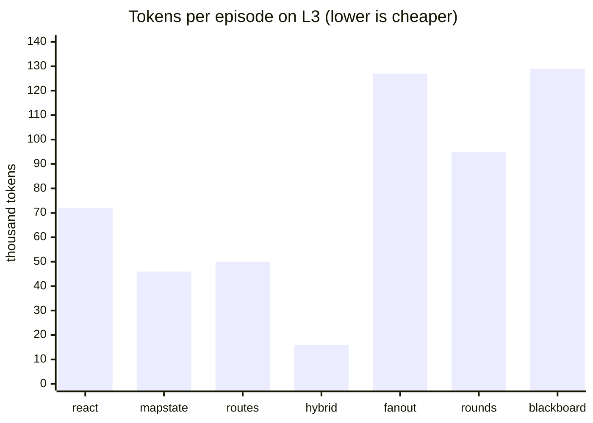

# M4: first comparison of seven architectures

> Development result (dev seeds). Must not be reported. One episode per architecture and level:
> these are tendencies from a first look, not measurements.

## In short

| Question | Tendency |
| --- | --- |
| Does an explicit map beat message history? (A1 vs A2) | No sign of it with this model |
| Does a route aid help? (A2 vs A2r) | No sign of it |
| How much needs a model? (A2r vs A6) | The clearest result: code walking the routes made A6 cheaper and more efficient on L2 and L3 |
| Do several scouts help? (A7–A9 vs A2) | Not in these small dungeons: 2–5× the tokens and more steps; A7 failed L3 |

## Questions

1. Does explicit memory beat history? (A1 ReAct vs A2 map state)
2. Does a planning aid help? (A2 vs A2r map state with routes)
3. How much of the work needs a model at all? (A2r vs A6 hybrid)
4. Does splitting the exploration between scouts help, and which way of coordinating them works
   best? (A7 fan-out once, A8 supervisor in rounds, A9 shared blackboard, each against A2, whose
   map-state agent is their scout)

## Setup

- Run `20261031-221233-react+mapstate+mapstate_routes+hybrid+fanout+rounds+blackboard`, commit
  `7818949`, a clean tree.
- Model `openai:gpt-6-luna`, temperature and reasoning at the provider's default, at most 4,096
  output tokens per call, token cap 2,000,000 per episode, prompt fingerprint `ff9afb3b9f66`.
- Levels L1–L3, dev seed 1000 of each, 1 repeat: 21 episodes. Step budget 6× the shortest
  solution (24, 60 and 108 steps).
- The whole run used 775,113 tokens and 1,419 seconds of episode time. No infrastructure errors.

## Results

From the run's `report.md`, section "Comparison". Efficiency is the shortest solution divided by
the steps of all scouts together; Δ is against the reference architecture in the last column.

### L1 (shortest solution 4 steps)

| Arch | Success | Efficiency | Steps | Tokens | Calls: orch / scouts | Latency | Scouts | Δ success | Δ efficiency | Reference |
| --- | --- | --- | --- | --- | --- | --- | --- | --- | --- | --- |
| react | 100% | 0.80 | 5 | 3,739 | 0 / 5 | 8.6s | 1 | — | — | — |
| mapstate | 100% | 1.00 | 4 | 3,040 | 0 / 4 | 7.2s | 1 | +0 pp | +0.20 | react |
| mapstate_routes | 100% | 0.50 | 8 | 6,382 | 0 / 8 | 11.1s | 1 | +0 pp | −0.50 | mapstate |
| hybrid | 100% | 0.50 | 8 | 3,690 | 0 / 8 | 9.5s | 1 | +0 pp | +0.00 | mapstate_routes |
| fanout | 100% | 0.44 | 9 | 9,503 | 1 / 9 | 20.1s | 1 | +0 pp | −0.56 | mapstate |
| rounds | 100% | 0.50 | 8 | 9,329 | 2 / 9 | 19.4s | 1 | +0 pp | −0.50 | mapstate |
| blackboard | 100% | 0.29 | 14 | 15,795 | 0 / 14 | 34.0s | 4 | +0 pp | −0.71 | mapstate |

### L2 (shortest solution 10 steps)

| Arch | Success | Efficiency | Steps | Tokens | Calls: orch / scouts | Latency | Scouts | Δ success | Δ efficiency | Reference |
| --- | --- | --- | --- | --- | --- | --- | --- | --- | --- | --- |
| react | 100% | 0.83 | 12 | 13,709 | 0 / 12 | 21.3s | 1 | — | — | — |
| mapstate | 100% | 0.53 | 19 | 17,012 | 0 / 19 | 29.5s | 1 | +0 pp | −0.31 | react |
| mapstate_routes | 100% | 0.56 | 18 | 16,223 | 0 / 17 | 26.3s | 1 | +0 pp | +0.03 | mapstate |
| hybrid | 100% | 0.71 | 14 | 5,826 | 0 / 11 | 11.7s | 1 | +0 pp | +0.16 | mapstate_routes |
| fanout | 100% | 0.26 | 39 | 42,310 | 1 / 40 | 44.2s | 2 | +0 pp | −0.27 | mapstate |
| rounds | 100% | 0.39 | 26 | 35,768 | 8 / 29 | 68.3s | 2 | +0 pp | −0.14 | mapstate |
| blackboard | 100% | 0.24 | 42 | 56,253 | 0 / 43 | 117.0s | 4 | +0 pp | −0.29 | mapstate |

### L3 (shortest solution 18 steps)

| Arch | Success | Efficiency | Steps | Tokens | Calls: orch / scouts | Latency | Scouts | Δ success | Δ efficiency | Reference |
| --- | --- | --- | --- | --- | --- | --- | --- | --- | --- | --- |
| react | 100% | 0.56 | 32 | 72,345 | 0 / 32 | 57.4s | 1 | — | — | — |
| mapstate | 100% | 0.39 | 46 | 46,391 | 0 / 46 | 79.5s | 1 | +0 pp | −0.17 | react |
| mapstate_routes | 100% | 0.38 | 47 | 50,055 | 0 / 46 | 74.0s | 1 | +0 pp | −0.01 | mapstate |
| hybrid | 100% | 0.50 | 36 | 16,419 | 0 / 25 | 27.0s | 1 | +0 pp | +0.12 | mapstate_routes |
| fanout | 0% | — | 108 | 127,359 | 1 / 108 | 214.4s | 2 | −100 pp | — | mapstate |
| rounds | 100% | 0.26 | 70 | 94,699 | 13 / 78 | 197.0s | 2 | +0 pp | −0.13 | mapstate |
| blackboard | 100% | 0.20 | 89 | 129,266 | 0 / 91 | 341.3s | 4 | +0 pp | −0.19 | mapstate |

## What the numbers suggest

**1. Memory (A1 vs A2).** No sign that the explicit map helps this model. A2 was better on L1
(efficiency 1.00 vs 0.80) and worse on L2 (0.53 vs 0.83) and L3 (0.39 vs 0.56). On L3 it used fewer
tokens (46,391 vs 72,345) but more steps. A possible reason for the tokens: A2 sends the current
map and its latest turn instead of the whole history; the map grows too, but more slowly. With gpt-6-luna, a
history of 32 steps was no problem for A1.

**2. Routes (A2 vs A2r).** No sign of a benefit: Δ efficiency −0.50 on L1, +0.03 on L2, −0.01 on
L3. The question was asked for a small model; this model may not need the aid.

**3. Code doing the walking (A2r vs A6).** The clearest tendency: A6 was more efficient on L2
(+0.16) and L3 (+0.12), equal on L1, and much cheaper. On L3 it used 16,419 tokens against 50,055
and took 27.0 s against 74.0 s, with 25 model calls for 36 steps.

**4. Scouts (A7–A9 vs A2).** Splitting did not help on any level. Every orchestrator was less
efficient than A2 (Δ between −0.13 and −0.71), used about two to five times its tokens, and took
longer, though scouts run at the same time in A7 and A8:

- A7 fan-out failed L3: its two scouts took 54 steps each and used up the 108-step budget without
  reaching the exit. On L1 it planned a single scout, so there was nothing to split.
- A8 supervisor was the best of the three (Δ −0.14 on L2, −0.13 on L3). It replanned often: 13
  orchestrator calls on L3, starting with two-step tasks for two scouts.
- A9 blackboard always used all four scouts and was the least efficient on L1 and L2 (0.29 and
  0.24), and the slowest everywhere, since its scouts take turns. The scouts hardly used claims:
  1 reply with a claim line out of 43 on L2, 2 out of 91 on L3.

Because efficiency counts the steps of every scout, several scouts can only win if they avoid
enough dead ends to make up for exploring in parallel. On these 3×3 to 5×5 dungeons they did not.

## How sure this is

Not sure at all. Each cell is one episode on one seed, so a single lucky or unlucky choice decides
it; L1 has a shortest solution of 4 steps, where one extra move lowers efficiency from 1.00 to 0.80. No test
separates these differences from chance. The A6 tendency (fewer tokens and steps on L2 and L3) and
the orchestrators' extra cost are the patterns most worth checking first.

## Limitations

- One seed per level and one repeat (21 episodes), chosen for speed on a paid model as a first
  look. Nothing here may be reported.
- One model, and not a small one: the questions about memory and planning aids were meant for
  small models such as the local qwen3.5-9b, so these answers may not carry over.
- A9's scouts were changed to take turns one at a time after a first local run, where scouts
  deciding at the same moment moved as one pack.
- A2r, A6 and A7–A9 were written by the agent at the experimenter's request.

## Next steps

- A possible follow-up: the same seven architectures on dev seed 1000 with 3 repeats on
  gpt-6-luna (63 episodes, roughly 70 minutes and 2.3 million tokens going by this run), to see
  whether these single episodes were luck. It needs a new run, since A8's round report changed
  after commit `7818949`; the comparison section could first gain the min–max across repeats.
- Try larger or sparser dungeons where parallel scouts could save dead ends, and a fan-out that
  limits each scout's share of the budget more tightly.
- Build A3–A5 (M6+) and add them on the same seeds.
